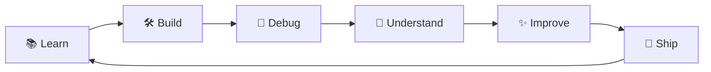

<!-- ===================== HEADER BANNER ===================== -->
<div align="center">


<a href="https://github.com/aryan-7050">
  
</a>

<br><br>

<a href="https://portfolio-7fei.vercel.app/">
  
</a>
<a href="https://github.com/aryan-7050">
  
</a>
<a href="YOUR_LINKEDIN_URL">
  
</a>
<a href="mailto:YOUR_EMAIL@gmail.com">
  
</a>

<br><br>


</div>

<br>

## 👨‍💻 About Me

```js
const aryan = {
  role: "Full-Stack Developer",
  location: "Pune, India 🇮🇳",
  stack: ["React", "Next.js", "Node.js", "Express", "MongoDB", "FastAPI"],
  currentlyLearning: ["Java DSA", "System Design", "Advanced TypeScript", "AI Engineering"],
  currentlyBuilding: "Scalable MERN apps with AI-powered features",
  philosophy: "Understand the technology, don't just use it.",
  funFact: "I debug until it makes sense, then I ship."
};
```

- 🔭 I build modern web apps with clean frontends, solid backends, and AI integration
- 🌱 Strengthening my problem-solving with **Java + DSA**
- ⚡ Passionate about **REST APIs, real-time apps, and scalable architecture**
- 🤖 Exploring **Generative AI, LangChain, and Gemini** to build intelligent products

<br>

## 🛠️ Tech Stack

<table>
<tr>
<td width="50%" valign="top">

### 💻 Languages


### 🎨 Frontend


### ⚙️ Backend

<br>
<sub>REST APIs · Socket.IO · JWT Auth</sub>

</td>
<td width="50%" valign="top">

### 🗄️ Databases

<br>
<sub>Mongoose · Schema Design</sub>

### 🤖 AI & Intelligent Systems

<br>
<sub>LangChain · Generative AI · Gemini · AI APIs</sub>

### 🧰 Tools


</td>
</tr>
</table>

<br>

## 🚀 Featured Projects

<!-- Replace the placeholders below with your real projects -->

<table>
<tr>
<td width="50%" valign="top">

### 🔹 Project One
Short one-line description of what this project does and why it matters.

**Tech:** `React` `Node.js` `MongoDB` `Socket.IO`

[🔗 Live Demo](#) · [📂 Source Code](#)

</td>
<td width="50%" valign="top">

### 🔹 Project Two
Short one-line description of what this project does and why it matters.

**Tech:** `Next.js` `TypeScript` `PostgreSQL`

[🔗 Live Demo](#) · [📂 Source Code](#)

</td>
</tr>
<tr>
<td width="50%" valign="top">

### 🔹 Project Three
Short one-line description of what this project does and why it matters.

**Tech:** `FastAPI` `Python` `LangChain` `Gemini`

[🔗 Live Demo](#) · [📂 Source Code](#)

</td>
<td width="50%" valign="top">

### 🔹 Project Four
Short one-line description of what this project does and why it matters.

**Tech:** `React` `Express` `MySQL`

[🔗 Live Demo](#) · [📂 Source Code](#)

</td>
</tr>
</table>

<br>

## 📊 GitHub Stats

<div align="center">


<br>


<br>


</div>

<br>

## 🎯 Current Focus

<table align="center">
<tr>
<td align="center" width="33%">

### ☕ Java + DSA
Sharpening problem-solving and algorithmic thinking.

</td>
<td align="center" width="33%">

### 🌐 Full-Stack
Building scalable MERN architecture and robust backends.

</td>
<td align="center" width="33%">

### 🤖 AI Engineering
Bringing AI capabilities into real-world applications.

</td>
</tr>
</table>

<br>

## 🔄 My Workflow

<div align="center">



</div>

> 💡 *I focus on understanding the technology behind the solution, not just using the technology.*

<br>

## 🏆 Core Competencies

<div align="center">


</div>

<br>

## 📚 Currently Learning

<div align="center">


</div>

<br>

## 🤝 Let's Connect

<div align="center">

I'm open to **internships, collaborations, and freelance opportunities**.
Feel free to reach out — let's build something great together!

<br>

<a href="https://portfolio-7fei.vercel.app/">
  
</a>
<a href="YOUR_LINKEDIN_URL">
  
</a>
<a href="https://github.com/aryan-7050">
  
</a>

<br><br>

**Code • Learn • Build • Evolve**

</div>

<!-- ===================== FOOTER ===================== -->

